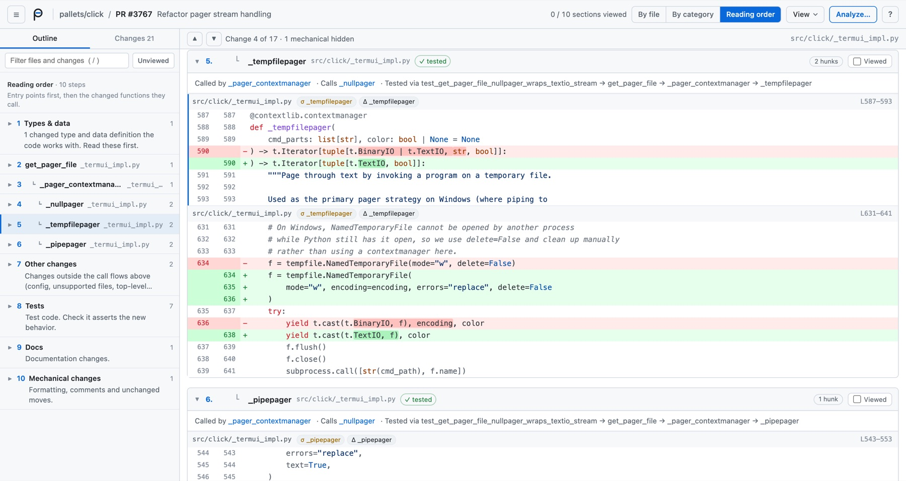

<p align="center">
  
</p>

<p align="center">
  <a href="https://github.com/sshah03/perspica/actions/workflows/ci.yml"></a>
  <a href="https://crates.io/crates/perspica"></a>
  <a href="https://github.com/sshah03/perspica/releases/latest"></a>
  <a href="LICENSE"></a>
  
</p>

<p align="center"><b>Review code changes by intent, learn the concepts behind them, and optionally gate PR merges until the change is provably understood.</b></p>

> [!NOTE]
> perspica is in beta. Expect rough edges, and behavior that may change between 0.x releases. If something looks wrong, please [open an issue](https://github.com/sshah03/perspica/issues).

perspica reads a diff by working out what actually changed (a rename, a new parameter, a moved function, a real logic change), setting aside the mechanical noise (reformatting, comments, rename-only lines, unchanged moves, generated files), and pointing at what a plain diff hides (references to names that no longer exist, calls that weren't updated for a new signature, code left unused).

Some of this can be done without an LLM. Perspica parses both versions with tree-sitter and follows the calls between them, so it's one local binary that answers in a few hundred milliseconds on a typical PR, gives the same answer every time, and needs no API key. An LLM is an optional, but useful, extra. What the LLM provides is grouping the changes by intent, rating the risk of each group, writing a summary, and generating lessons + quizzes on the more significant changes in the PR (if needed).

It understands **TypeScript and JavaScript** (including TSX and JSX), **Python**, **Rust**, **Go**, **Java**, **Kotlin**, **Scala**, **C#**, **C**, **PHP** and **Ruby** (Rails included). Files in other languages still show up, but as ordinary line diffs.

If you're reviewing your own work done with coding agents (Claude Code or Codex session) perspica shows what you asked for in your own words and, with an LLM, marks which parts you asked for and which the agent decided on its own by looking through your sessions. Only you will ever be able to see this section.

As alluded to above, for more significant changes the **Learn** tab explains it. Focus is on the few concepts or architecture changes that matter for the change. It will provide a short lesson, a diagram or animation when one helps, and a quiz to check you've got it. When there's nothing new to learn, it says so. **[See the demo video for Learn](#learn)**.

<a href="docs/media/perspica-demo.mp4"></a>

<sub>Reviewing [pallets/click#3767](https://github.com/pallets/click/pull/3767) (analysis, reading order, terminal) and [colinhacks/zod#6587](https://github.com/colinhacks/zod/pull/6587) (summary, checks, split view). The agent-session example is illustrative. [Full-quality video (MP4)](docs/media/perspica-demo.mp4).</sub>

**[See it on real pull requests](https://sshah03.github.io/perspica/)** from ripgrep, Flask, Spark and more. Nothing to install.

## Install

```bash
cargo install perspica
```

Or with Homebrew:

```bash
brew install sshah03/perspica/perspica
```

Or with the install script, which puts the binary in `~/.local/bin`:

```bash
curl -fsSL https://raw.githubusercontent.com/sshah03/perspica/main/install.sh | sh
```

Or download a binary for macOS, Linux or Windows from [Releases](https://github.com/sshah03/perspica/releases), or build from source:

```bash
git clone https://github.com/sshah03/perspica && cd perspica
cargo build --release          # → target/release/perspica
```

## Use

Inside a repository:

```bash
perspica                 # review your current branch: commits, uncommitted and untracked files
perspica --web           # …in the browser
perspica --pr 123 --web  # a GitHub pull request (uses the `gh` CLI)
perspica --pr 123 --post # post the review on your own pull request
```

Other targets:

```bash
perspica --branch develop                 # against another base branch
perspica --staged                         # staged changes
perspica --git main...feature             # a range (merge-base, like a PR)
perspica --git HEAD~3                     # the working tree against a commit
perspica old.ts new.ts                    # two files
perspica --json                           # machine-readable output
perspica --pr 123 --format html           # the viewer as one file to share, with any saved analysis
```

Everything above works on its own. The optional LLM analysis (`-s`, or **Analyze…** in the viewer) runs through Claude Code, an API key or Ollama; see [LLM analysis](#llm-analysis) for setup. Alternatively you can ask your coding assistant to run it for you.

## What you get

**Limited Noise.** Formatting, comment-only edits, lines that differ only by a rename, code moved unchanged, generated and vendored files are tagged and collapsed, so the lines that carry real changes stand out. Tests and docs are their own tier.

**Every change named.** Renames (even when the body was also edited), signature changes (new required vs. optional parameters), dependency changes per module and symbol, extractions into new functions, moves within and across files, logic changes per function and method.

**What a diff hides.**
- a renamed or removed name still used anywhere in the repository (for a method, only calls on its own type, so a common name like `Flush` doesn't raise false alarms);
- calls to a changed function that weren't updated (only for changes that can actually break a caller);
- code the change left unused.

**A reading order.** Changed code from the entry points down to the changed functions they call (the order you'd want someone to walk you through it), and which of them the changed tests actually reach, with the call path.

<picture>
  <source media="(prefers-color-scheme: dark)" srcset="docs/images/reading-order-dark.jpg">
  
</picture>

**What you asked for.** If the change was made with Claude Code or Codex on your machine, perspica shows your prompts from the sessions that edited these files. With an LLM analysis, each group of changes is marked *asked*, with a short quote checked word for word against your prompts, or *agent's call*: the agent decided it on its own.

**Intent, risk and a summary (optional).** With an LLM, changes are grouped by what they're for, each with a risk level and what to verify, plus a summary and the model's notes. Those are kept apart from what perspica found in the code, and labeled as less certain.

**The concepts behind it (optional).** With an LLM, the Learn tab explains the ideas the change relies on and quizzes you on them. See [Learn](#learn).

## LLM analysis

Optional. `-s` in the terminal, or **Analyze…** in the viewer (with a model picker and a *Standard* or *Thorough* depth).

**Setup.** There's no key to paste anywhere. perspica uses whichever of these you have:

- **Claude Code.** perspica uses your Claude Code login, so no API key is needed; if you already use it, there's nothing to set up. New to it? Install [Claude Code](https://claude.com/claude-code) and run `claude auth login`. Analyses and lessons run this way count toward your Claude plan's usage, like any other Claude Code request.
- **An API key** in your environment. Add it to your shell profile (`~/.zshrc`, `~/.bashrc`) and open a new terminal:
  ```bash
  export ANTHROPIC_API_KEY=sk-ant-…     # or OPENAI_API_KEY
  ```
- **A local model with Ollama.** Install [Ollama](https://ollama.com), download a model and keep Ollama running:
  ```bash
  ollama pull gemma4:12b      # about 16 GB of RAM; qwen3-coder:30b with 32 GB
  ```
  perspica picks the best model you've downloaded (or choose one in the viewer, or with `--model`). Local models are slower and less precise than hosted ones: about a minute for a 10-file PR on an M4 Pro. `OLLAMA_HOST` points it at another machine.

If none is found, **Analyze…** in the viewer shows these steps, and *Check again* picks up a Claude Code login or Ollama without restarting. When there are several, the order is `--api-key` / `--provider` or `PERSPICA_API_KEY` (and `PERSPICA_PROVIDER`), then `ANTHROPIC_AUTH_TOKEN` (gateways), `ANTHROPIC_API_KEY`, `OPENAI_API_KEY`, Claude Code, Ollama; `--provider ollama` picks the local model over the rest. Prefer the environment to `--api-key`, which leaves the key in your shell history.

The default Claude model is `claude-opus-5-5`; `--model claude-sonnet-5-5` is faster, `claude-haiku-5-5` (or the older `claude-haiku-4-5`) is a quick first pass. What's sent: the list of classified changes and the changed code, never whole files (Thorough may also read definitions and files under 200 lines from the changed files). Analyses are saved per diff in `.git/perspica/`, so reloading or running again doesn't pay for the same analysis twice; `--fresh` reruns. Up to 100,000 characters of changed code are sent (16,000 to a local model). For a bigger change, **Analyze…** says how big it is and offers to send all of it, and `--full-context` does the same in the terminal; otherwise the model is told which files it can't see.

## Learn

The **Learn** tab, next to Review in the viewer, picks out the concepts you need to understand this change. An architecture change comes first, then an algorithm, a protocol rule or a language feature it depends on. A small change gets one concept and a bigger one up to three. Formatting, renames and changes that need no background get "nothing to learn" instead of filler.

Each concept has:

- a one-line summary, and the idea in everyday terms;
- how it works, and where it shows up in this change, with links to the code;
- a diagram, animation or small interactive piece when one helps (often the text is enough);
- links to the documentation it comes from;
- a quiz of one to three questions, to check you've understood it before you approve the change.

<a href="docs/media/perspica-learn-demo.mp4"></a>

<sub>Learn on [pallets/flask#5818](https://github.com/pallets/flask/pull/5818) (architecture diagram), [charmbracelet/lipgloss#591](https://github.com/charmbracelet/lipgloss/pull/591) (a hands-on piece and a quiz) and [encode/uvicorn#2985](https://github.com/encode/uvicorn/pull/2985) (an animation and a quiz). [Full-quality video (MP4)](docs/media/perspica-learn-demo.mp4).</sub>

Learn uses the same setup as [LLM analysis](#llm-analysis): open the tab, pick a model, and perspica looks for concepts. Each lesson is written the first time you open its concept, and saved in `.git/perspica/` with the analysis, so it's only written once. A second pass checks each lesson against the code and fixes what's wrong, and the viewer fixes any text in the figure that overlaps, gets cut off or is too small to read. So a lesson takes a few minutes to write. If a lesson isn't good enough, **Rewrite…** writes it again, with a stronger model if you like. Lessons are kept in `--format html` exports, so a shared review keeps its lessons and quizzes.

## Decisions

The **Decisions** tab shows how a change you made with Claude Code or Codex was decided. perspica reads the session that made it and groups what was settled into topics. Each topic separates what you decided from what the agent decided on its own, so you know which choices nobody has looked at yet. Below that is a timeline of the moments that settled it: your requests, the agent's proposals, measurements and changes of course. Every quote is checked word for word against the session, and anything that doesn't match is dropped.

It only works for your own changes, with the sessions on this machine: uncommitted work, or commits you authored. A session counts when it edited the changed files, and perspica reads it up to where it moved on to other work. **Find decisions…** sends the session and the changed code to your LLM in one request, which takes about a minute. The result is saved in `.git/perspica/`. Shared `--format html` pages leave Decisions out, since it quotes your sessions.

## On your pull request

Post the review on your pull request as one comment, so reviewers get it without installing anything. Run `perspica --pr 123 --post`, or click **Post to PR #123…** in the viewer when the review is of your own branch or PR. You can see a preview of what you'll be posting before pushing it. It uses the `gh` CLI and your GitHub login.

The comment is a relatively short summary of everything you see (intent, key learnings, etc...), here are the key optional things you can include: 

- **Your quiz score.** Once you've answered every question in Learn, the comment shows a badge with how many you got right first try, and so does the perspica check's title. The badge image comes from shields.io.
- **Ask reviewers to take the quiz.** The comment suggests it, and it stays optional. With the perspica check in the repo, reviewers answer by replying `/quiz 1a 2c 3b`, or in their approval, and the check grades them and replies with what they missed.
- **Wait for a reviewer to pass.** The perspica check waits until a reviewer passes the quiz. To keep the PR from merging until then, make `perspica` a required check in the repo's branch settings. It's an honor system: the answers are in the comment's data, so the check shows someone took the quiz, not proof they understood.

Nothing from your agent sessions goes in, so no prompts, no Decisions, etc...

## The GitHub Action

The Action turns the comment into a check on the pull request, grades reviewers' quiz answers, and gives every pull request a summary, even when its author never ran perspica.

### Set it up

1. In your repository, run `perspica github init`. It writes `.github/workflows/perspica.yml`.
2. Commit that file and merge it into your default branch. The workflow only runs from there, so nothing happens on pull requests until then.
3. Optional, to let quizzes block merging, in the repository's **Settings → Branches**, add or edit the rule for your default branch, turn on **Require status checks to pass before merging**, and add `perspica`. It shows up in that list once the workflow has run on a pull request. We assumed most people wouldn't want to make passing the quiz mandatory, but if you do, the setting is there.

That's all for the repository. Authors post with `perspica --pr 123 --post` or **Post to PR…** in the viewer, which needs perspica and the `gh` CLI logged in. Reviewers don't install anything, they just read the comment and reply with `/quiz` + the answers (e.g. /quiz 1a 2d 3b 4c).

If you'd rather not install perspica to set it up, save this as `.github/workflows/perspica.yml`. It's the same file `perspica github init` writes:

```yaml
name: perspica
on:
  pull_request_target:
    types: [opened, synchronize, reopened]
  issue_comment:
    types: [created, edited]
  pull_request_review:
    types: [submitted]
permissions:
  contents: read
  pull-requests: write
  issues: write
  checks: write
  statuses: write
concurrency:
  group: perspica-${{ github.event.pull_request.number || github.event.issue.number }}
jobs:
  update:
    if: >-
      github.event_name == 'pull_request_target' || github.event_name == 'pull_request_review' ||
      (github.event.issue.pull_request && (contains(github.event.comment.body, 'perspica:data') || contains(github.event.comment.body, '/quiz')))
    runs-on: ubuntu-latest
    timeout-minutes: 10
    steps:
      - uses: sshah03/perspica@v0.5.1
        with:
          require-author-quiz: "false"
```

### What it does

On every pull request it keeps a **perspica** status up to date, which is the one to make required, and a **perspica review** check with the details and line notes:

- With the author's comment: the summary, what each change is for, concerns and lessons on the check's page, and where the quiz stands.
- Without one: perspica's structural review, which needs no model. That's what's mechanical, what's tests, which files are safe to skim, and references or calls the change may have broken, marked on their lines.

It runs when a pull request is opened or updated, and on comments and reviews. It installs the perspica release it was written for, and it reads the pull request's code but never runs it, so it's safe on pull requests from forks. It needs permission to write comments, checks and statuses, and only reads the code. On private repos, GitHub counts each run as about a minute of your Actions minutes.

After upgrading perspica, run `perspica github init` again to move the workflow to the new version, or let Dependabot update the `uses` line.

### Requiring the author's quiz

Off by default. Run `perspica github init --require-author-quiz`, or set `require-author-quiz: "true"` in the workflow, and the check waits until each pull request's author has answered every question in perspica's quiz right. If they haven't, the Action replies to tell them their score and how to retake it: in Learn, **Start over** on a concept, then post again. The badge then says which try it took. A change that Learn finds nothing to teach in passes as it is. To block merging until then, make `perspica` a required check.

## Privacy

- Everything initially runs locally. Nothing is sent anywhere unless you ask for it: `-s` / **Analyze…**, **Find concepts…** in Learn (after that, opening a concept writes its lesson), or **Find decisions…**.
- Agent sessions (`~/.claude/projects`, `~/.codex/sessions`) are read only for **your own** changes (uncommitted work, or commits authored with your git identity), never for someone else's PR. perspica says when it uses them; `--no-sessions` turns this off.
- `--post` and **Post to PR…** send only the analysis, lessons and quiz to GitHub, after a preview. Your sessions stay on your machine.
- The web viewer listens on `127.0.0.1` and only answers its own page: other hosts (DNS rebinding) and other sites' requests are refused.
- Learn's interactive pieces are written by the model, so they run in a sandboxed frame that can't reach the network or the rest of the page.

## Languages and file roles

The semantic analysis covers TypeScript and JavaScript, Python, Rust, Go, Java, Kotlin, Scala, C#, C, PHP and Ruby. Every other file is shown as a line diff, with syntax highlighting where available, whitespace-only changes collapsed and its role (test, docs, generated…).

File roles come from paths and codegen markers; override them in `.gitattributes` with `linguist-generated`, `linguist-vendored`, `linguist-documentation`, or `perspica-role=source|test|docs|generated|vendored`.

<details>
<summary><b>Command-line reference</b></summary>

```
Usage: perspica [OPTIONS] [OLD_FILE] [NEW_FILE]

Arguments:
  [OLD_FILE]  Old file path
  [NEW_FILE]  New file path

Options:
  -l, --language <LANGUAGE>  Override language detection
  -f, --format <FORMAT>      Output format: tty (default), json, web, html (the viewer saved as one file, see --out) [default: tty]
      --out <OUT>            Where --format html writes the page [default: perspica-review.html]
      --json                 Shorthand for --format json
      --web                  Open results in browser
      --port <PORT>          Port for web viewer (the next free port is used if taken) [default: 7890]
      --no-open              Don't open a browser tab (web mode)
      --no-color             Disable colored output
      --show-noise           Show mechanical changes (formatting, renames, moves) in full in the terminal
      --staged               Diff staged changes
      --git [<GIT>]          Diff working tree against HEAD, or specify a commit range (a..b, a...b, or a ref)
      --pr <PR>              Review a GitHub pull request by number (uses the `gh` CLI)
      --branch [<BASE>]      Review the current branch against its merge-base with <BASE> (default: origin/HEAD, main or master). What `perspica` does with no arguments
  -s, --summarize            Group changes by intent, with risk and a summary, using an LLM. Sends the change list and changed code, never whole files
  -d, --deep                 Thorough analysis: the LLM may first read definitions and small files from the changed files. Slower. Implies -s
      --api-key <API_KEY>    LLM API key (better: set it in the environment, see the README)
      --provider <PROVIDER>  With --api-key: anthropic (default) or openai. `ollama` needs no key and uses a local model
      --model <MODEL>        Model to use instead of the provider's default
      --no-sessions          Don't read the Claude Code or Codex sessions behind your change (your prompts are shown, and sent with -s). Never read for other people's changes
      --fresh                Run the LLM analysis again even if a saved one matches this diff
      --full-context         Send all of the changed code to the LLM, however large. By default perspica sends up to 100,000 characters (16,000 for local models)
  -h, --help                 Print help
  -V, --version              Print version
```

Viewer shortcuts: `j`/`k` next/previous change · `n`/`p` next/previous file or group · `v` mark viewed and go to the next unviewed file · `f`/`i`/`r` by file / by intent / reading order · `m` show/hide mechanical changes · `u`/`s` unified/split · `/` filter · `l` switch between Review and Learn · `d` switch to Decisions and back · `e`/`q` explanation/quiz in Learn (`j`/`k` change concept) · `?` all shortcuts.

</details>

<details>
<summary><b>How it works</b></summary>

`perspica-core` is a library with no I/O: source strings in, structured results out. It parses both sides with tree-sitter, fingerprints every item (token-level hashes that ignore formatting and comments), matches items across versions (by name, by shape for renames, by similarity for renamed-and-edited ones), classifies the differences, then links display hunks to them and tags the mechanical lines. Cross-file passes find moves between files, names that vanished, affected call sites, and a call graph (by name, gated on the caller importing the callee's module) for the reading order and test reach.

`perspica` (the CLI) collects the change from git (one `git diff` and one `git cat-file --batch`), renders it to the terminal, JSON or the embedded web viewer, and runs the optional LLM analysis, whose output is checked against perspica's own analysis (unknown entries dropped, "asked" quotes checked against the actual prompts).

```
crates/perspica-core/src   parser · diff · classify · cross_file · annotate · roles · flow · languages/
crates/perspica-cli/src    main · git · sessions · intel · llm · deep · web · render_tty
crates/perspica-cli/web    the viewer (no build step)
tests/fixtures             change-type fixtures, and real PRs from other projects (tests/fixtures/real)
```

Development: `cargo test` runs everything, including real pull requests from [Flask](https://github.com/pallets/flask/pull/5928) and [ky](https://github.com/sindresorhus/ky/pull/881) as fixtures.

</details>

## License

MIT
